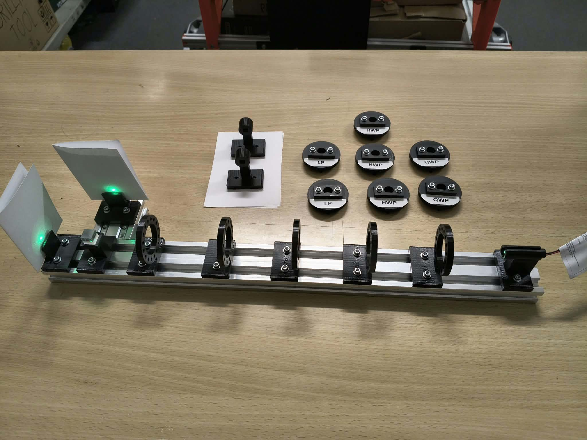

# Building a single-qubit optical simulator

I started this project because I wanted to see the mathematics I was studying in quantum informatics do something on a table. Instead of multiplying another pair of matrices on paper, I wanted to prepare a state, put a gate in its path, and watch the result change.



*My finished optical setup. The beam travels from the laser on the right through the cassette positions to the polarizing beam splitter on the left. The loose cassettes are the gates and polarizers I swap into the beam.*

Polarization gave me a practical way to do this. A beam has horizontal and vertical field components, and wave plates transform their amplitudes and relative phase using the same two-dimensional mathematics as a single qubit. **This is a classical optical analog, not a quantum computer or a single-photon experiment.** What I built is a way to explore that mathematics with real components.

## From a laser spot to a gate

My first idea was fairly small: a laser, a few optical elements and paper targets, with the one-input Deutsch–Jozsa algorithm as the experiment I wanted to reach. It grew into a rail with five positions for removable cassettes. I modeled and printed the holders, gave them 22.5° indexing, and prepared three half-wave plates (HWP), two quarter-wave plates (QWP) and two linear polarizers (LP).

I power the laser from a **3 V power supply**. I also found that the laser itself is polarized. Before inserting any cassettes, I orient it so that the laser and polarizing beam splitter (PBS) alone produce roughly equal output spots. Starting around 50/50 has worked best experimentally. I then use an LP to prepare H or V for the gate experiments; the initial equal split is a source adjustment, not the prepared input state.

```text
Laser, 3 V → LP: prepare H or V → wave plates: gates / oracle → PBS → two spots
```

Once that was working, I could replace symbols in a calculation with physical cassettes. An HWP at 22.5° gave the Hadamard analog. Two of them brought the light back toward its starting polarization. At 45°, the plate swapped the bright output like an X gate. A third plate let me insert a phase oracle between two Hadamards and try the Deutsch–Jozsa sequence.

| Experiment | What I was looking for |
| --- | --- |
| LP and PBS | Prepare H and V and identify the two outputs |
| One Hadamard | Turn H into approximately equal H/V outputs |
| Two Hadamards | Return toward H: $H^2=I$ |
| NOT and double NOT | Swap H/V, then try returning to the input |
| Deutsch–Jozsa | Distinguish identity and Z phase oracles through $HZH=X$ |
| QWP and a final analyzer | Reveal a relative-phase difference hidden in H/V intensity |

The last experiment is now photographed too. After the final analyzer, I estimated roughly 80/20 without the QWP and 40/60 with it. That is the qualitative distinction I wanted to see, with real optical errors still visible; the ideal predictions are 100/0 and 50/50.

## The part I did not finish

Alongside the optics, I designed and assembled an ATtiny13A/TS912 board for two BPW34 photodiodes, a button and two indicator LEDs. I programmed the controller through an Arduino Nano as ISP and tested the button, mode switching and PWM. I also got to debug the fairly ordinary problem of LEDs installed the wrong way around.

I did not finish connecting the photodiodes into the optical readout. For these demonstrations I used the spots on paper. The electronics could have made comparisons more objective, but they would not have corrected imperfect wave plates. By that point the optical setup was already doing what I had wanted to learn from it, so I stopped there.

I did not keep the original firmware source. The [reference sketch](firmware/README.md) is explicitly an unverified reconstruction; it is not the program I originally uploaded.

I have written the rest as the route I took through the project: [the mathematics that made it possible](docs/01-theory.md), [the optical parts and how I set them up](docs/02-optical-components.md), [building the mechanics and electronics](docs/03-hardware-and-development.md), [the experiments with photographs](docs/04-experiments.md), and [what the imperfect results taught me](docs/05-limitations-and-lessons.md). The [CAD](construction/README.md), [circuit details](docs/electronics-reference.md) and [preserved design history](docs/evidence/README.md) are here for anyone who wants to look closer.

**Laser safety:** never look into the beam or specular reflections; use suitable beam stops and laser safety practices. The 3 V figure describes the electrical supply, not optical power; I have not established the installed laser's wavelength or optical power.
