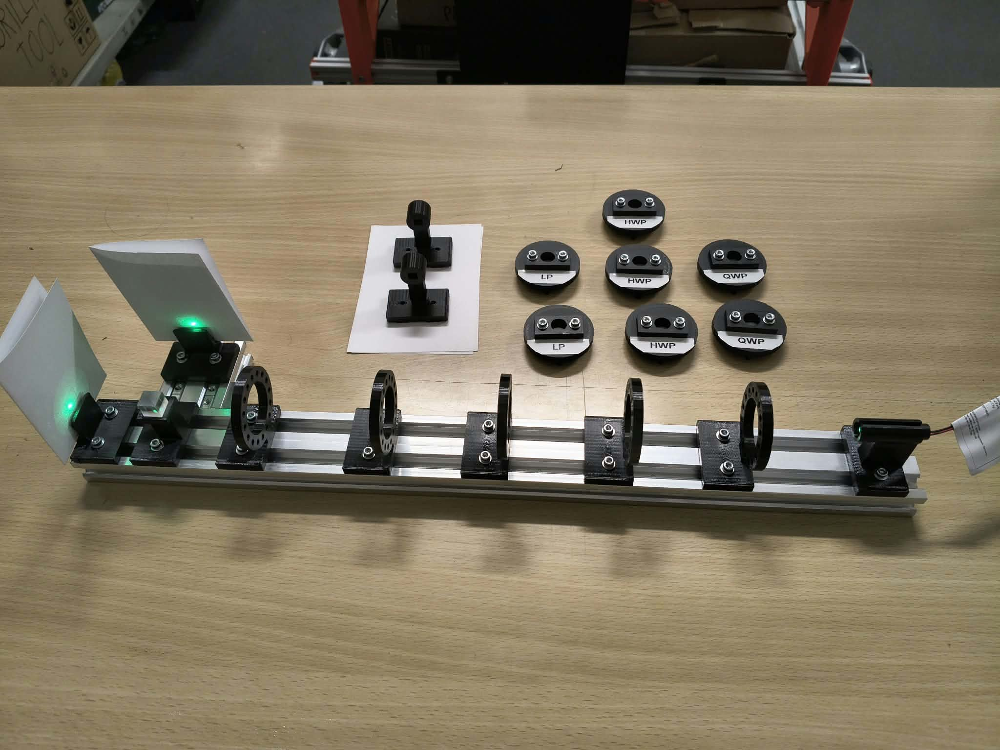
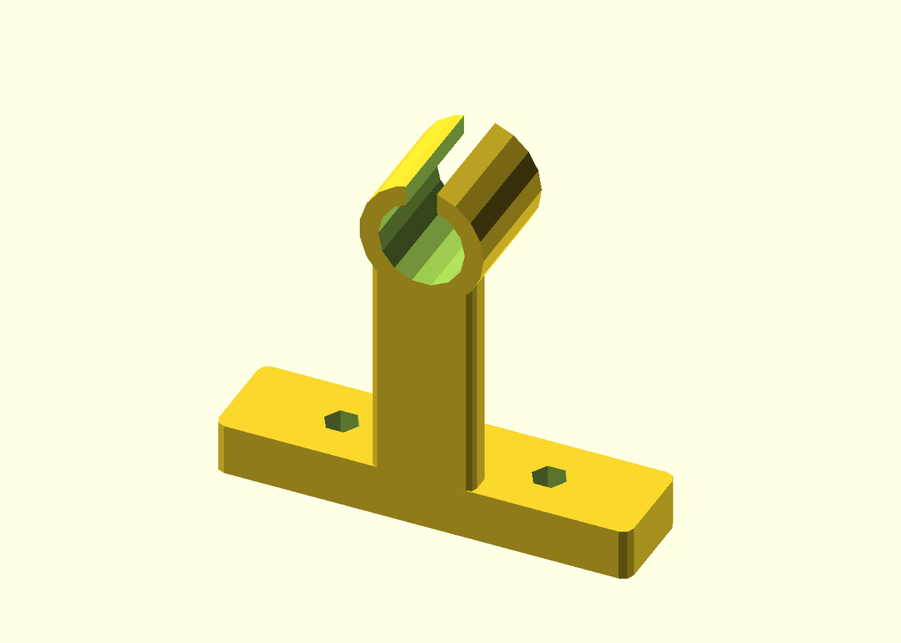
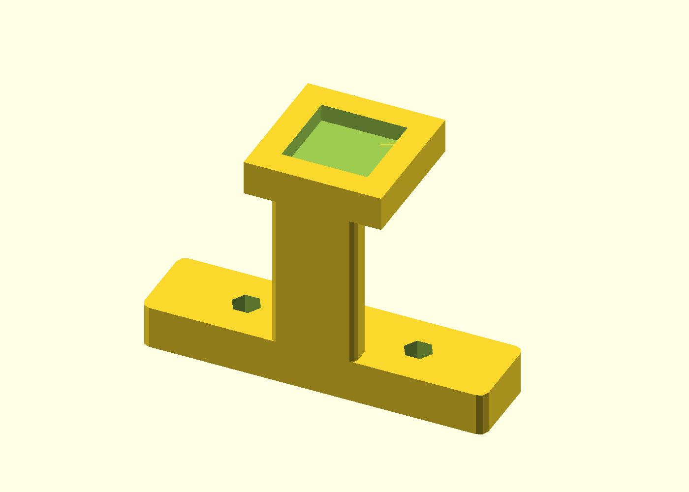
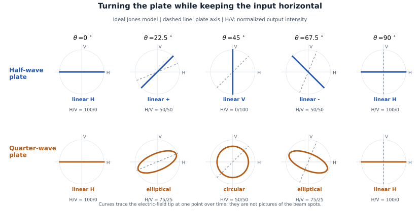

# Putting the optics together

[Project](../README.md) · [The mathematics](01-theory.md) · [Next: building the apparatus](03-hardware-and-development.md)

I wanted to be able to change a calculation without rebuilding the apparatus. The physical version of that idea was a set of small foil cassettes: take one out, rotate it, put another in, and compare the two output spots.



*The seven labeled cassettes beside the rail. The empty holders let me see the laser/PBS starting configuration before preparing an input.*

The built setup has five cassette positions. My saved OpenSCAD assembly shows four, so it represents an earlier arrangement rather than the full photographed rail. The holders share a cassette interface, and the indexed ring has sixteen positions: $360^\circ/16=22.5^\circ$ per step.

## Starting with the laser

I power the laser from a **3 V power supply**. I found that it is already polarized, so its orientation matters even before I add any foils. I start with every cassette removed and adjust the laser's orientation until the PBS produces approximately equal spots. In practice this roughly 50/50 starting point has given me the best results.

| Laser holder | PBS holder |
| --- | --- |
|  |  |

*The two end components use the same rail-mounting idea. These are CAD previews of the holders.*

I keep the laser adjustment separate from state preparation. Equal H/V intensity does not mean unpolarized light, and it does not determine relative phase. Once I insert an LP, its axis defines the linear polarization that goes into the gates.

For H input I align the LP with one PBS basis direction; rotating it by 90° prepares V. In the ideal model, an LP transmits intensity proportional to $\cos^2\phi$ for incident linear polarization at angle $\phi$ to its axis. It prepares a state by discarding some light. Starting with roughly equal H/V components helps avoid strongly favoring one preparation direction, but my reason for using that alignment is the practical result I observed.

I name the two PBS channels H and V using the LP test. Their labels refer to polarization, not to an assumption that H must be transmitted or reflected.

## What a wave plate changes

The useful picture for me is the electric field at one fixed point in the beam. For linear polarization its tip moves back and forth along a line. For circular polarization it goes around a circle; elliptical polarization is the more general oval-shaped case.

A wave plate has two perpendicular optical axes, called fast and slow. I resolve the input field along those axes, introduce a relative phase delay between the components, then combine them again. A half-wave plate (HWP) gives a half-cycle phase difference, $\pi$; a quarter-wave plate (QWP) gives a quarter-cycle difference, $\pi/2$. This is the basic retarder picture described in [Edmund Optics' wave-plate guide](https://www.edmundoptics.com/knowledge-center/application-notes/optics/understanding-waveplates/).

Turning the cassette rotates these axes relative to the incoming polarization. For an ideal plate at its design wavelength, it changes which components receive that phase difference, rather than changing the nominal retardance. Here $\theta$ is the plate-axis angle from H, and $\phi$ is the angle of an incoming **linear** polarization.

## Turning an HWP

For a linear input, an ideal HWP keeps the output linear. In my [Jones convention](01-theory.md#turning-a-plate-into-a-matrix),

```math
W_{1/2}(\theta)=
\begin{pmatrix}
\cos(2\theta)&\sin(2\theta)\\
\sin(2\theta)&-\cos(2\theta)
\end{pmatrix},
```

so applying it to a linear state gives

```math
W_{1/2}(\theta)
\begin{pmatrix}\cos\phi\\\sin\phi\end{pmatrix}
=
\begin{pmatrix}
\cos(2\theta-\phi)\\
\sin(2\theta-\phi)
\end{pmatrix}.
```

In other words, **the output angle is $2\theta-\phi$**. I can picture this as reflecting the input polarization direction across the plate axis. Keeping the input fixed and turning the plate by 22.5° turns the output direction by 45°.

For H input, $\phi=0^\circ$: a plate at 22.5° produces 45° diagonal polarization. For diagonal input, $\phi=45^\circ$, the same plate gives $2(22.5^\circ)-45^\circ=0^\circ$, or H. This is the physical version of a Hadamard taking H to + and + back to H.

| HWP axis $\theta$ | Input H, at 0° | Input +, at 45° |
| --- | --- | --- |
| 0° | H | − |
| 22.5° | + | H |
| 45° | V | + |
| 67.5° | − | V |
| 90° | H | − |

Here + means the 45° diagonal state and − the orthogonal −45°/135° diagonal state. Directions separated by 180° describe the same linear polarization; the table ignores global phase.

This also explains a less obvious case: the HWP at 0° acts as Z, but it leaves H input looking unchanged. On + input it changes the relative sign and produces −. I need to specify the input as well as the plate angle.

## Turning a QWP

A QWP changes the relative timing by a quarter-cycle. The result depends on how the input is oriented to its axes:

- If a linear input lies along either plate axis, it stays linear in the same direction: there is only one component to delay.
- At 45° to the axes, the two components are equal. Their quarter-cycle phase difference gives circular polarization.
- At intermediate angles, both components are present but unequal, giving elliptical polarization.

The 45° condition is also illustrated in this [Harvard polarization demonstration](https://sciencedemonstrations.fas.harvard.edu/presentations/circular-polarization). It is the angle **between the input polarization and the plate axes** that matters.

I use the convention $Q(0^\circ)=\operatorname{diag}(1,i)$, where $i^2=-1$. With H input, the plate at 0° has nothing to act on in the V component:

```math
Q(0^\circ)|H\rangle=
\begin{pmatrix}1&0\\0&i\end{pmatrix}
\begin{pmatrix}1\\0\end{pmatrix}
=\begin{pmatrix}1\\0\end{pmatrix}.
```

With + input, the same setting has two equal components:

```math
Q(0^\circ)|+\rangle=
\begin{pmatrix}1&0\\0&i\end{pmatrix}
\frac1{\sqrt2}\begin{pmatrix}1\\1\end{pmatrix}
=\frac1{\sqrt2}\begin{pmatrix}1\\i\end{pmatrix}.
```

That is the circular state used in my phase experiment. If I keep H input instead and turn the QWP to 45°, I also get a circular state:

```math
Q(45^\circ)|H\rangle=
\frac12\begin{pmatrix}1+i\\1-i\end{pmatrix}
=\frac{e^{i\pi/4}}{\sqrt2}\begin{pmatrix}1\\-i\end{pmatrix}.
```

The common factor is a global phase. The opposite signs of $i$ distinguish the two circular states in this convention; I avoid assigning physical left/right labels without a defined viewing direction and identified axes.

| QWP axis $\theta$ | Linear H input | Linear + input |
| --- | --- | --- |
| 0° | Linear H | Circular |
| 22.5° | Elliptical | Elliptical |
| 45° | Circular | Linear + |
| 67.5° | Elliptical | Elliptical |
| 90° | Linear H | Circular |

A QWP can also turn circular input back into linear polarization. For example, applying $Q(0^\circ)$ to $(1,i)^T/\sqrt2$ gives $(1,i^2)^T/\sqrt2=(1,-1)^T/\sqrt2$, the − diagonal state. Its effect is determined by the input state and its orientation together.

## Seeing the rotation in one picture



*Calculated ideal states for fixed H input. Each curve traces the electric-field tip at one point over a cycle; it is not the path of the beam or a picture of the output spot. The dashed line shows the chosen plate axis.*

For H input, the ideal intensity formulas make the difference especially clear:

```math
P_V^{\mathrm{HWP}}=\sin^2(2\theta),
\qquad
P_V^{\mathrm{QWP}}=\frac12\sin^2(2\theta),
\qquad
P_H=1-P_V.
```

At 22.5°, the HWP gives 50/50, while the QWP gives 75/25. At 45°, the HWP gives 0/100, while the QWP gives 50/50. These are model predictions, not measurements of my foils.

The PBS only compares H/V intensity. Diagonal linear and circular states can both give 50/50. In the [phase experiment](04-experiments.md#6-looking-for-the-phase-that-hv-could-not-show), I add an HWP before the PBS to change the analysis basis and distinguish their relative phases.

## Following the beam in practice

The discrete angles make the nominal gate settings convenient, but the optical axis belongs to the foil, not to its printed label. A cassette can fit perfectly while the true axis is offset. Retardance also depends on wavelength. I have not identified the installed laser's wavelength, optical power or exact foil models, so I keep the ideal examples separate from the real calibration.

For the gate experiments, my chain is

```text
Laser → LP input → HWP / QWP sequence → PBS → two paper targets
```

I leave unused holders empty. The most crowded sequence here is the QWP comparison with its final analyzer: LP, HWP, QWP, HWP. It uses four of the five positions.

The two spots are enough to follow the qualitative changes. I also made holders and a circuit for two BPW34 photodiodes, but did not finish that readout. The next chapter is the story of that mechanical and electronic work.

---

**Next chapter:** [Building the apparatus](03-hardware-and-development.md) →
