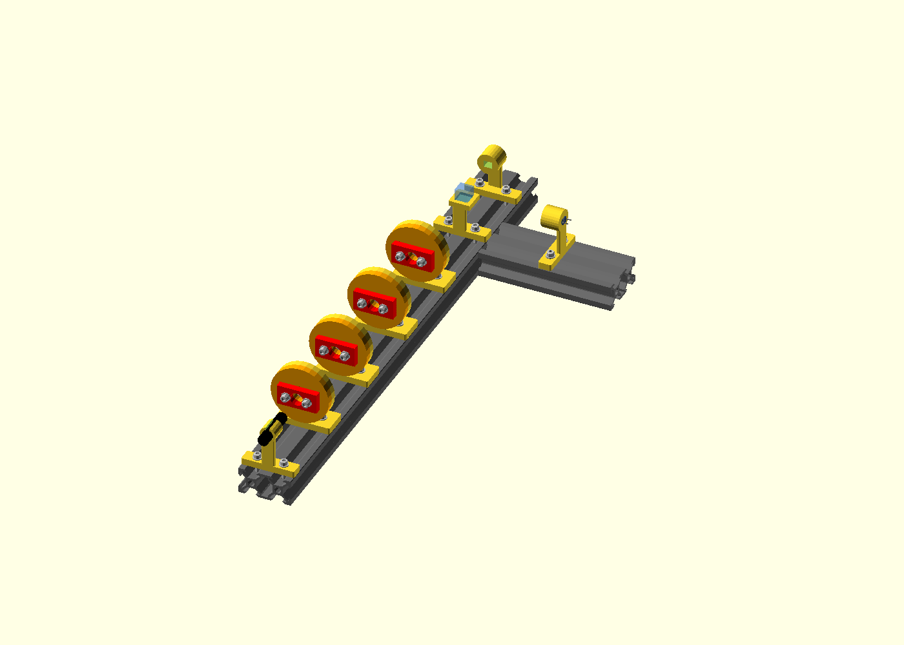
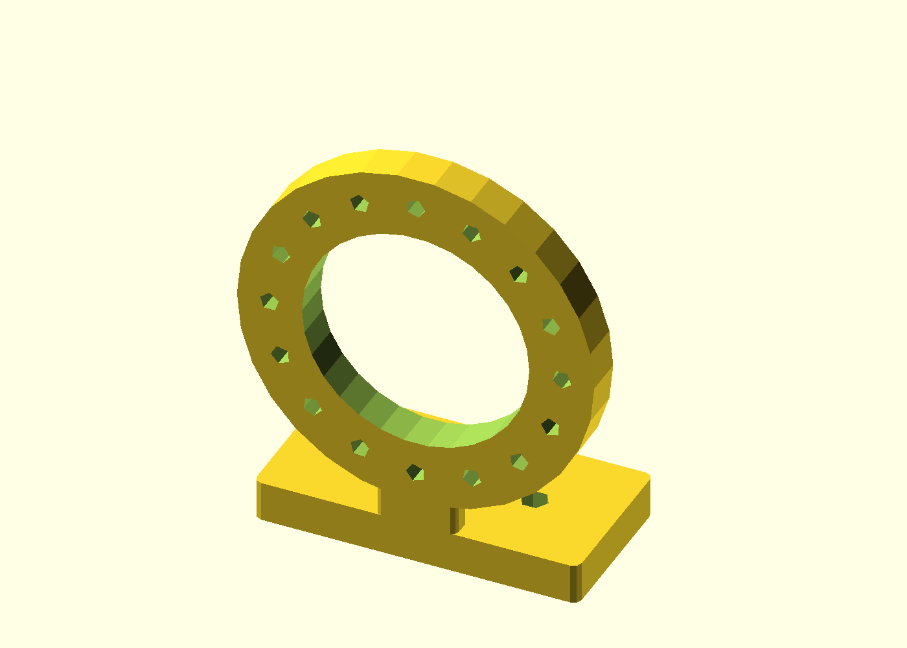
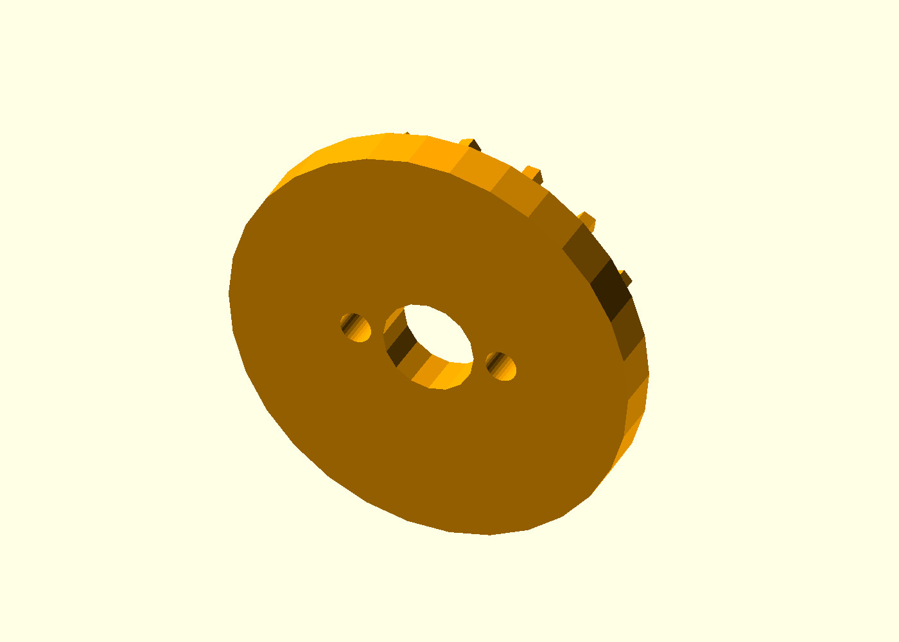
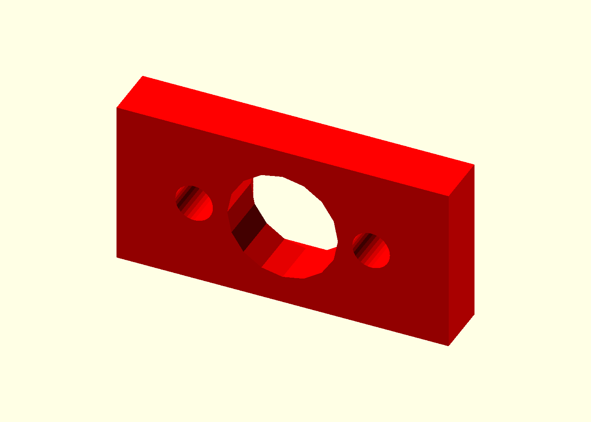
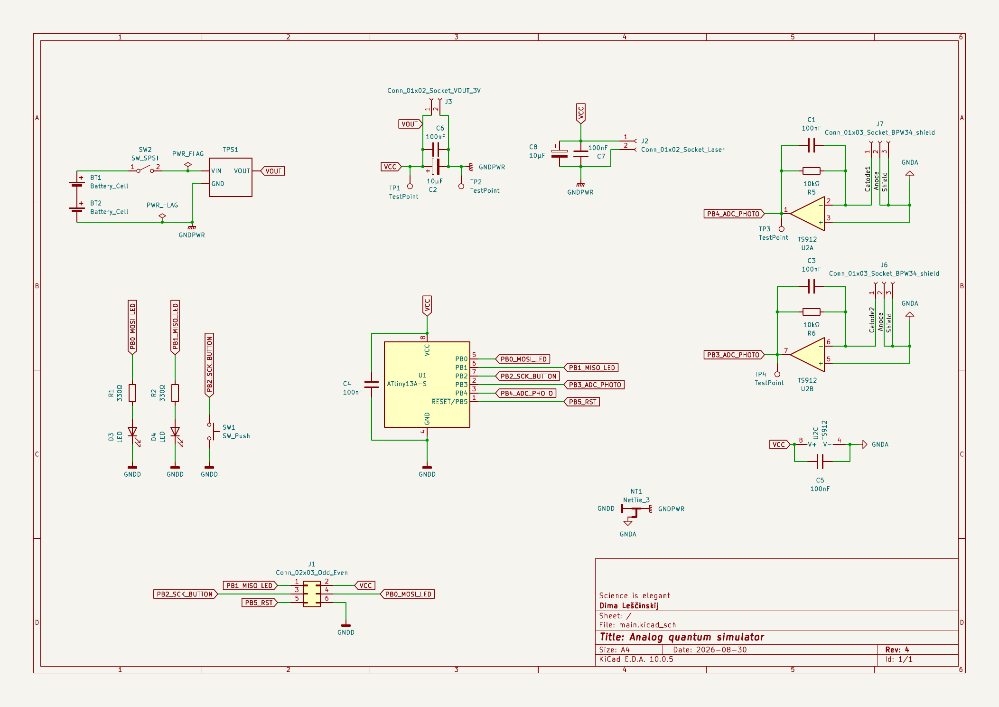
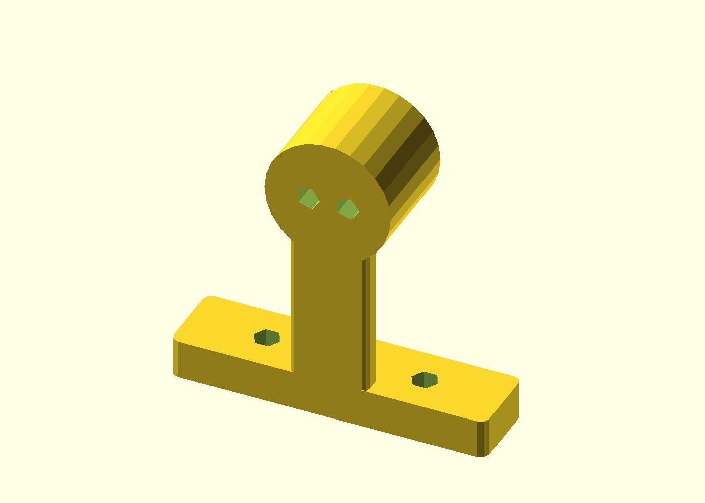
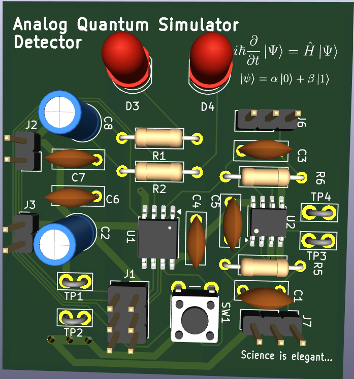

# Building the apparatus

[Project](../README.md) · [The optical parts](02-optical-components.md) · [Next: trying the gates](04-experiments.md)

I started thinking about this project around August 2026 while studying quantum informatics at CTU FIT. The idea was to make a small demonstration of a single qubit's mathematics, especially the one-input Deutsch–Jozsa algorithm. At first I imagined a fairly passive arrangement: choose an oracle, put the appropriate optical parts in the beam, and look at the outputs on paper.

That remained the essential experiment. What changed was how much work I put into making it reusable. I wanted to swap gates without rebuilding their mounts and to return to useful angles without starting the alignment again.

## A rail and removable gates

I modeled the mechanical parts in OpenSCAD, printed them, and ordered the small screws, nuts and other hardware needed to assemble them. The rail gave the laser, foil holders and PBS a common mechanical reference. Each optical cassette could be removed and reused in another holder.

*My CAD assembly shows the main optical rail and the reflected detector branch. This model has four cassette holders; the physical setup below has five.*

The rotation mechanism has a fixed indexed ring and a removable rotor carrying the foil cassette. Sixteen positions around a full turn give 22.5° steps, which include the nominal settings for Z, Hadamard and X. This was convenient for changing gates, although I later had to keep the distinction between a mechanical setting and the foil's true optical axis in mind.

| Fixed indexed ring | Removable rotor | Foil cassette |
| --- | --- | --- |
|  |  |  |

*The three pieces of the cassette mechanism. The fixed ring provides the indexed positions, the rotor carries the cassette, and the foil sits in its own replaceable holder.*

*The physical result: five cassette positions, three HWP cassettes, two QWP cassettes and two LP cassettes. The two spare detector holders stand beside the rail.*

I kept the [shared dimensions](../construction/config/parameters.scad) together and made separate [cassette and rotation modules](../construction/parts/rotation_plate.scad), so the same interface could be reused along the rail. The [printing guide](../construction/README.md) describes how I separated printable parts from assembly views containing optics and metal hardware.

I mounted the LP, HWP and QWP foils in those cassettes and used a PBS to split the outgoing polarization into two visible spots. For the optical experiments I power the laser from a 3 V power supply. Finding that the laser itself was polarized also changed my setup routine: I first orient the bare laser for roughly equal PBS outputs, then insert the LP and gates. That starting point worked best in practice, without making the later plates ideal.

## From two spots to two electrical signals

Looking at the spots let me see which output was brighter, but I also wanted an electronic way to compare them. My plan was to put a BPW34 photodiode in each PBS output path and bring both signals back to one board.

I designed the circuit around a TS912 dual operational amplifier and an ATtiny13A controller. Each photodiode needed its own analog channel; the two amplifier sections could then feed the controller, while a button and two LEDs provided the local interface.

*My schematic. The two detector channels are on the right, the controller is in the center, and the LEDs and button are on the left. The [original PDF](../images/schema.pdf) is available for a closer look.*

The BPW34 produces a photocurrent. In each channel I used the TS912 with feedback from its output to the inverting input to convert that current into a voltage. The feedback path contains a 10 kΩ resistor and a parallel 100 nF capacitor. The two outputs connect to the ATtiny's analog-input nets.

I put the detector connections on external sockets so the photodiodes could sit at the two optical outputs. The board also has test points for the supply and the two amplifier outputs, making those nodes accessible during debugging. The [circuit reference](electronics-reference.md) gives the full connections and component values.

*The BPW34 holder model for the planned detector channels. Making these mounts was one part of the readout work; the complete optical measurement chain remained unfinished.*

## Turning the circuit into a board

I laid out a custom PCB to bring the two detector channels, controller and interface together, then assembled it. The controller and amplifier use surface-mount packages, while the LEDs, button, connectors and passive components are through-hole parts.

*The PCB design in 3D. U1 is the ATtiny13A and U2 is the TS912. This is a render of the board, not a photograph of the assembled hardware.*

The two LEDs gave me something I could check while bringing the controller up, before the optical measurement chain was complete. The button let me switch operating states. I also included the six-pin ISP connection so I could program the ATtiny on the board.

The [PCB layout](../electro/main/main.kicad_pcb), [schematic source](../electro/main/main.kicad_sch), [BOM](../electro/main/main.csv) and [fabrication files](../electro/main/gerber/) contain the design details.

## Programming and bringing the board to life

I programmed the ATtiny13A using an Arduino Nano configured as ISP. The Nano acted as programmer; afterward the ATtiny ran the uploaded program itself. I tested the button, switching between four operating states, and PWM/LED control.

One problem turned out to be in the assembly: I had installed the LEDs the wrong way around. Correcting their orientation made the indicators work. That gave me a working controller and interface to build on.

I did not keep the original firmware source. The [companion sketch](../firmware/reference/attiny13a_reference_reconstruction.ino) is an **illustrative, unverified reconstruction**, not the program I uploaded. I keep the details of that gap in the [firmware notes](../firmware/README.md).

## Why the final demonstrations used the spots

Getting the button and LEDs working was one step toward the readout. I still needed to finish wiring and soldering the photodiodes into the optical setup and calibrate the detector channels. I did not complete that part, so I have no photodiode intensity measurements from the finished apparatus.

Meanwhile, I could already perform the optical experiments. A Hadamard split the prepared H input, another brought it back toward H, and an X gate moved the bright spot to the other output. The phase-oracle sequence gave the qualitative difference between constant and balanced cases that I had wanted to see.

The imperfect results also helped me decide where to stop. The electronics would have made comparisons more objective, but they would not have corrected a wave plate's axis or retardance. Calibrating a detector channel could remove its gain bias; it could not remove an imbalance already present in the light.

By that point, the optical setup met my original educational goal. I chose to finish with the visible demonstrations and leave the electronic readout as an unfinished part of the build. The next chapter follows those experiments through the actual cassette arrangements and output spots.

---

**Next chapter:** [Trying the gates, one cassette at a time](04-experiments.md) →
