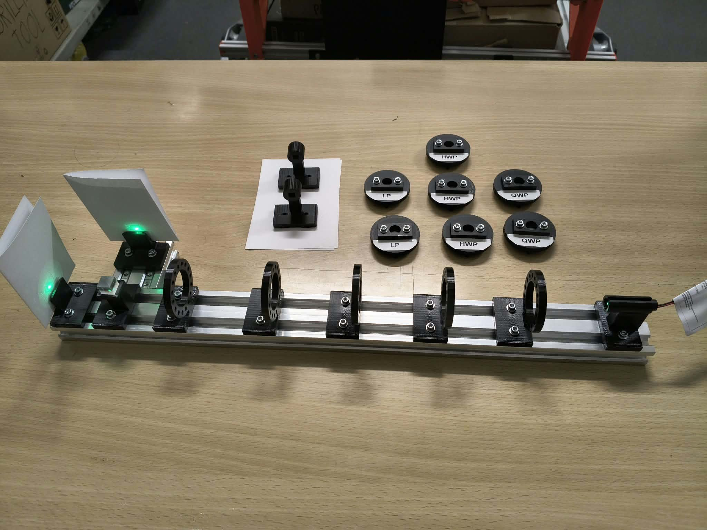

# Building the apparatus, and the electronics beside it

[Project](../README.md) · [The optical parts](02-optical-components.md) · [Next: trying the gates](04-experiments.md)

I started thinking about this project around August 2026 while studying quantum informatics at CTU FIT. The idea was to make a small demonstration of a single qubit's mathematics, especially the one-input Deutsch–Jozsa algorithm. At first I imagined a fairly passive arrangement: choose an oracle, put the appropriate optical parts in the beam, and look at the outputs on paper.

That remained the essential experiment. What changed was how much work I put into making it reusable. I wanted to swap gates without rebuilding their mounts and to return to useful angles without starting the alignment again.

## A rail and removable gates

I modeled the mechanical parts in OpenSCAD, printed them, and ordered the small screws, nuts and other hardware needed to assemble them. The rail gave the laser, foil holders and PBS a common mechanical reference. Each optical cassette could be removed and reused in another holder.

The rotation mechanism has a fixed indexed ring and a removable rotor carrying the foil cassette. Sixteen positions around a full turn give 22.5° steps, which include the nominal settings for Z, Hadamard and X. This was convenient for changing gates, although I later had to keep the distinction between a mechanical setting and the foil's true optical axis in mind.

*The physical result: five cassette positions, three HWP cassettes, two QWP cassettes and two LP cassettes. The two spare detector holders stand beside the rail.*

The [saved assembly](../construction/assemblies/full.scad) contains four indexed holders; the photograph records the five-position build I used. I have kept the original CAD as it was. The [shared dimensions](../construction/config/parameters.scad), [cassette geometry](../construction/parts/rotation_plate.scad) and [printing guide](../construction/README.md) preserve the design, including separate printable parts and assembly views.

I mounted the LP, HWP and QWP foils in those cassettes and used a PBS to split the outgoing polarization into two visible spots. For the optical experiments I power the laser from a 3 V power supply. Finding that the laser itself was polarized also changed my setup routine: I first orient the bare laser for roughly equal PBS outputs, then insert the LP and gates. That starting point worked best in practice, without making the later plates ideal.

## Why I made a detector board

Looking at the spots was enough to see a change, but I also wanted an electronic way to compare the outputs. My plan was to put a BPW34 photodiode in each PBS path, feed the signals through an amplifier, and use a small controller with LEDs and a button.

I designed a custom PCB around an ATtiny13A and a TS912 dual operational amplifier, then assembled the board. The [schematic](../electro/main/main.kicad_sch), [PCB layout](../electro/main/main.kicad_pcb), [BOM](../electro/main/main.csv) and [Gerber files](../electro/main/gerber/) are still in the repository.

The analog part has one amplifier channel per detector. Each uses an inverting detector input with a resistor and capacitor feeding back from the output: a transimpedance arrangement intended to turn photocurrent into a voltage. The two outputs go to the controller's PB4 and PB3 analog-input nets. The LEDs and button share other pins with the ISP connector.

There was more iteration here than the final parts list suggests. My saved KiCad history begins on 29 August with the controller, amplifier and photodiode symbols. The supply drawing changed from an early TPS63000 symbol to an unnamed supply block. Detector connections became external three-pin sockets. Feedback resistors changed from 100 kΩ to 10 kΩ, and the two feedback capacitors later changed from 47 pF to 100 nF. The design also gained test points and a three-way connection between analog, digital and power ground.

Those are changes I can trace in the saved files. I do not have measurements or notes that explain every value change, so I have not invented a tuning story around them. I kept the detailed chronology, circuit nets and package-pin table in the [electronics reference](electronics-reference.md). A [portable copy of the KiCad history](evidence/README.md) preserves all 630 commit objects, including the extra states from its reflog.

## Firmware implementation and source preservation

I programmed the ATtiny13A using an Arduino Nano configured as ISP. The Nano acted as programmer; afterward the ATtiny ran the uploaded program itself. I tested the button, switching between four operating states, and PWM/LED control.

One problem turned out to be physical rather than a firmware feature: I had installed the LEDs the wrong way around. After correcting their orientation, the indicators worked. The schematic shows LED anodes driven through resistors and cathodes connected to ground.

Unfortunately, I did not preserve the original sketch. The repository search included untracked and hidden files, the manufacturing ZIP, root Git history and every stored object in the nested KiCad history. It recovered circuit and layout development, but no original source or firmware binary.

That leaves a real gap in the record. I know the controller behavior I tested, but I cannot recover the exact four mode definitions, ADC usage, debounce timing, clock or fuse settings from the files. The schematic establishes circuit connections; it cannot reconstruct the code I uploaded.

The [companion sketch](../firmware/reference/attiny13a_reference_reconstruction.ino) is therefore an **illustrative, unverified reconstruction**. Its four LED patterns and software PWM are examples, not my recovered firmware. It remains unchanged, with its compilation guard in place, and has not been compiled or flashed as part of this documentation work. The [firmware notes](../firmware/README.md) explain that distinction.

## Where the two parts of the project diverged

Getting the button and LEDs working did not mean the light measurement was finished. I had not fully wired and soldered the photodiodes into the optical setup, and I never reached a calibrated, complete detector readout. There is no photodiode intensity dataset here.

Meanwhile, I could already perform the optical experiments. A Hadamard split the prepared H input, another brought it back toward H, and an X gate moved the bright spot to the other output. The phase-oracle sequence gave the expected qualitative difference between constant and balanced cases. More plates also exposed more imperfections: some sequences returned much more cleanly than others.

The QWP comparison gave another useful example. After the final analyzer I estimated around 80/20 without the QWP and around 40/60 with it, rather than the ideal 100/0 and 50/50. I could see the distinction, but I could also see the limits of the components and my alignment.

Finishing the electronics would have helped me measure those differences. It would not have corrected them. A detector gain adjustment cannot fix a wave plate's retardance or make a genuine optical imbalance disappear.

I decided to close the project with the optical demonstrations, the unfinished readout documented alongside them, and the files needed to understand both. The mechanics made it easy to try different sequences. The electronics taught me to distinguish a working controller from a working measurement chain. Preserving this account also made the missing firmware source a lesson I could not overlook.
