# Trying the gates, one cassette at a time

[Project](../README.md) · [The mathematics](01-theory.md) · [What I learned](05-limitations-and-lessons.md)

I began with the simplest question the apparatus could answer: could I prepare a polarization and recognize it at the outputs? From there I added one plate, then two, and eventually the phase-oracle sequence I had wanted to build.

For all of these experiments I power the laser from a **3 V power supply**. Before inserting foils, I orient the polarized laser until the laser and PBS alone give roughly equal spots. That is the starting adjustment that has worked best for me. The LP then prepares H or V; I do not use the bare laser's 50/50 split as a substitute for that preparation.

The chains below run from laser to PBS, omitting empty holders. I reference angles to the H/V optical axes established with the LP, rather than assuming a printed zero is exact.

## Reading the calculations

Before putting in the first gate, I need a way to describe what goes into it. I write the polarization as a column vector:

$
|\psi\rangle=\begin{pmatrix}\alpha\\\beta\end{pmatrix},
\qquad
|H\rangle=|0\rangle=\begin{pmatrix}1\\0\end{pmatrix},
\qquad
|V\rangle=|1\rangle=\begin{pmatrix}0\\1\end{pmatrix}.
$

The notation $|\psi\rangle$ is just a name for that vector. The top entry is the horizontal field amplitude and the bottom entry is the vertical amplitude. I normalize them so $|\alpha|^2+|\beta|^2=1$. The PBS reads out the squared magnitudes:

$
P_H=|\alpha|^2,\qquad P_V=|\beta|^2.
$

Thus $(1,0)^T$ gives 100/0, while $(1,1)^T/\sqrt2$ gives 50/50 because $(1/\sqrt2)^2=1/2$. The entries themselves are amplitudes, not percentages. Negative entries do not mean negative brightness. For complex entries, $i^2=-1$ and $|a+ib|^2=a^2+b^2$ for real $a,b$; I will need this in the QWP experiment.

A gate acts by multiplying its matrix by the state column. Each output entry is a row of the matrix multiplied by the column:

$
G|\psi\rangle=
\begin{pmatrix}a&b\\c&d\end{pmatrix}
\begin{pmatrix}\alpha\\\beta\end{pmatrix}
=
\begin{pmatrix}a\alpha+b\beta\\c\alpha+d\beta\end{pmatrix}.
$

If light passes through gate A and then gate B, I calculate $B(A|\psi\rangle)=BA|\psi\rangle$: the matrix closest to the state acts first. I can either follow the state after each plate or multiply the gate matrices first.

This is also how ideal single-qubit quantum gates act on qubit states. My beam uses the same algebra, with normalized classical intensities in place of single-photon outcome probabilities.

## The gate matrices I use

These are all the gate matrices needed for the experiments below:

$
I=\begin{pmatrix}1&0\\0&1\end{pmatrix},
\qquad
X=\begin{pmatrix}0&1\\1&0\end{pmatrix},
$

$
Z=\begin{pmatrix}1&0\\0&-1\end{pmatrix},
\qquad
H=\frac1{\sqrt2}\begin{pmatrix}1&1\\1&-1\end{pmatrix},
$

$
Q=\begin{pmatrix}1&0\\0&i\end{pmatrix}.
$

I is identity: it leaves the vector unchanged and needs no plate in the oracle position. X swaps the two entries; I implement it with an HWP at 45°. Z changes the sign of the V amplitude, using an HWP at 0°. H mixes the two amplitudes, using an HWP at 22.5°. Plain $H$ means the **Hadamard matrix**, while $|H\rangle$ means the **horizontal state**.

For Q I use a QWP at 0°, with the convention that it multiplies the V amplitude by $i$. All five matrices preserve normalization in the ideal model. The LP prepares the input before these gates; it is a lossy optical element, rather than one of these unitary gates.

I judged the results by the spots on paper. The ideal fractions come from the matrices; my approximate real ratios are visual estimates. I did not use the unfinished photodiode readout or calculate intensities from camera pixels.

## 1. Finding H and V

I first put only the LP in the beam:

`LP(H) → PBS`, then `LP(V) → PBS`.

Rotating it by 90° let me identify the two output channels. For ideal H input, $(1,0)^T$, all the output is H; for V, $(0,1)^T$, all is V. I therefore expected 100/0 and 0/100.

| LP set to H | LP set to V |
| --- | --- |
| 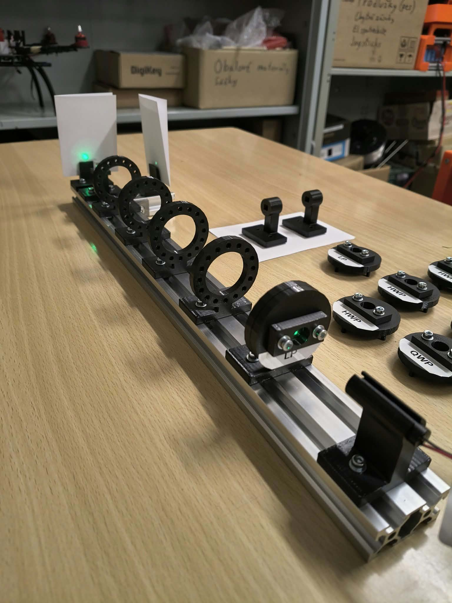 | 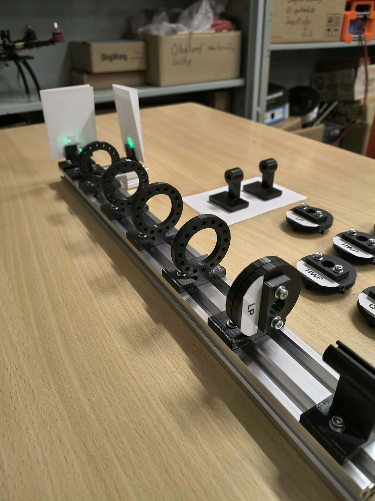 |

*The same setup with the LP rotated. I used this comparison to name the output channels.*

The bright output changed as expected. It gave me a reference for the rest of the experiments, although weak light in the other direction could still come from imperfect extinction, alignment or scattering. I did not measure an extinction ratio.

## 2. Putting in a Hadamard

Next I kept H preparation and inserted an HWP at 22.5°:

`LP(H) → HWP(22.5°) → PBS`.

The calculation was short enough to keep beside the apparatus:

$$
\begin{aligned}
H|H\rangle
&=\frac1{\sqrt2}
\begin{pmatrix}1&1\\1&-1\end{pmatrix}
\begin{pmatrix}1\\0\end{pmatrix}\\
&=\frac1{\sqrt2}
\begin{pmatrix}1\cdot1+1\cdot0\\1\cdot1+(-1)\cdot0\end{pmatrix}\\
&=\frac1{\sqrt2}\begin{pmatrix}1\\1\end{pmatrix}
=\frac{|H\rangle+|V\rangle}{\sqrt2}=|+\rangle.
\end{aligned}
$$

Both components have squared magnitude $1/2$, so I expected two equal spots. That is approximately what I saw.

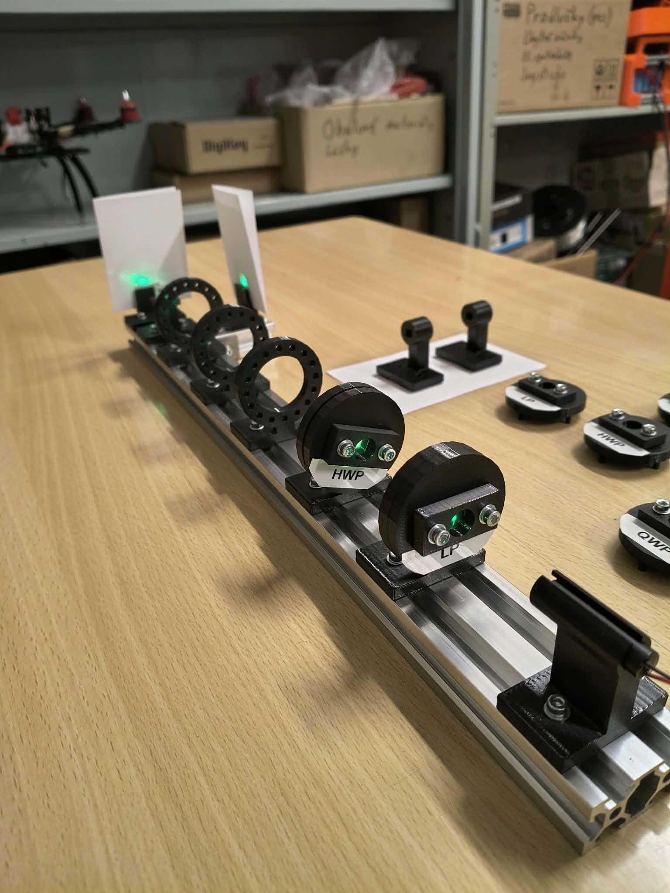

*H preparation followed by the nominal 22.5° HWP.*

This was the first direct connection between a gate matrix and a visible change. It was also only one input tested in one basis: a 50/50 output by itself cannot establish the relative phase or certify the whole Hadamard transformation.

## 3. Adding a second Hadamard

I then inserted another HWP at the same nominal angle:

`LP(H) → HWP₁(22.5°) → HWP₂(22.5°) → PBS`.

This time I can multiply the gate matrices before applying them to the input. Each entry of the product comes from a row of the left matrix and a column of the right one:

$
\begin{aligned}
HH
&=\frac12
\begin{pmatrix}1&1\\1&-1\end{pmatrix}
\begin{pmatrix}1&1\\1&-1\end{pmatrix}\\
&=\frac12
\begin{pmatrix}
1\cdot1+1\cdot1 & 1\cdot1+1\cdot(-1)\\
1\cdot1+(-1)\cdot1 & 1\cdot1+(-1)\cdot(-1)
\end{pmatrix}\\
&=\frac12\begin{pmatrix}2&0\\0&2\end{pmatrix}
=\begin{pmatrix}1&0\\0&1\end{pmatrix}=I.
\end{aligned}
$

The two factors $1/\sqrt2$ give the $1/2$ in front. The off-diagonal entries cancel, and the diagonal entries become one. This is the identity matrix for **any input state**, not just H.

For the input I prepared here,

$
HH|H\rangle=I\begin{pmatrix}1\\0\end{pmatrix}
=\begin{pmatrix}1\\0\end{pmatrix}=|H\rangle.
$

I therefore expect H again, or 100/0. The output returned close to the original polarization.

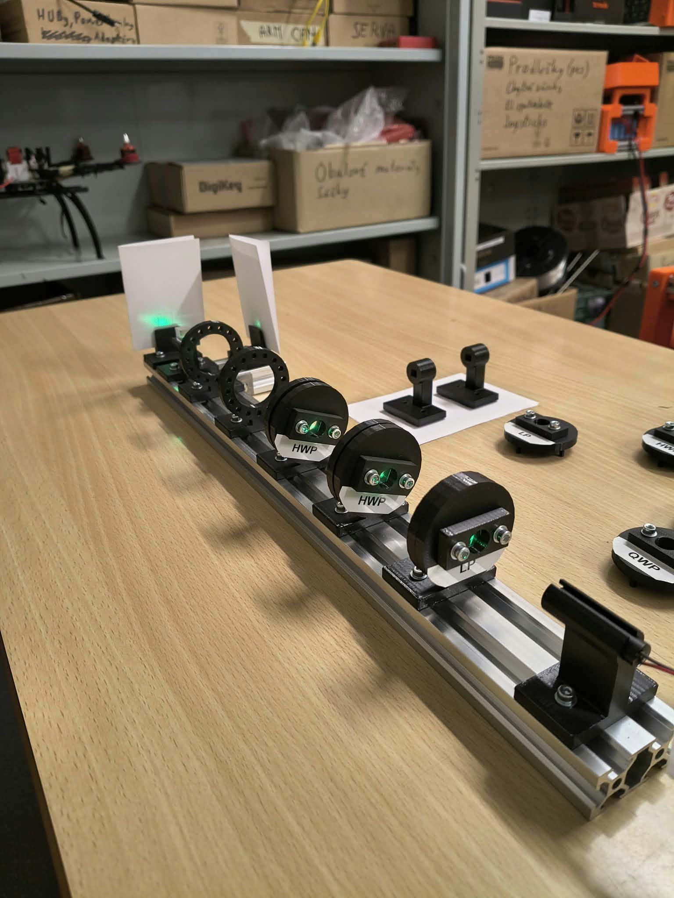

*Two physical plates implementing the nominal $H^2$ sequence.*

The important difference from the calculation is that these are two separate foils. They need not have identical retardance or identical offsets between their optical axes and cassette marks. Returning approximately to H was useful evidence for the sequence, but not proof that it acted as identity on every possible input.

## 4. Swapping the output, then trying to swap it back

For NOT, I changed the HWP setting to 45°:

`LP(H) → HWP(45°) → PBS`.

The X matrix swaps the two amplitudes. For my H input,

$
X|H\rangle=
\begin{pmatrix}0&1\\1&0\end{pmatrix}
\begin{pmatrix}1\\0\end{pmatrix}
=\begin{pmatrix}0\\1\end{pmatrix}=|V\rangle.
$

It also works in the other direction:

$
X|V\rangle=
\begin{pmatrix}0&1\\1&0\end{pmatrix}
\begin{pmatrix}0\\1\end{pmatrix}
=\begin{pmatrix}1\\0\end{pmatrix}=|H\rangle.
$

For the photographed H input, I expect $(P_H,P_V)=(|0|^2,|1|^2)=(0,1)$, or 0/100. I saw the bright output move to the other channel, with some residual light left behind.

I also tried two NOT plates:

`LP(H) → HWP₁(+45°) → HWP₂(+45° or −45°) → PBS`.

| One NOT | Double NOT |
| --- | --- |
| 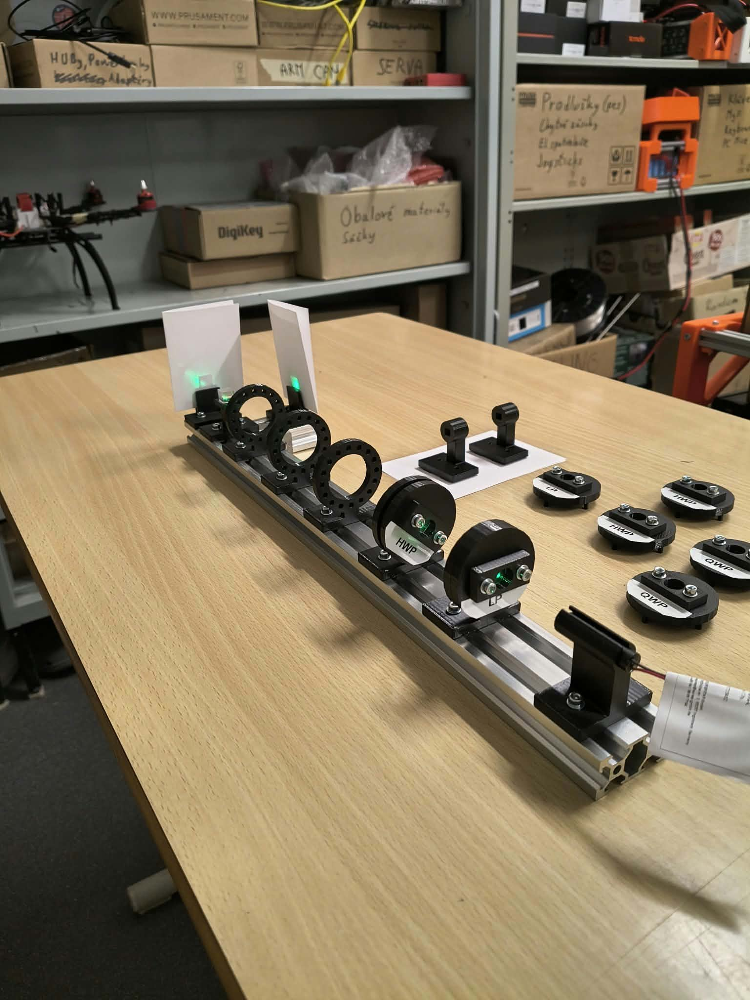 | 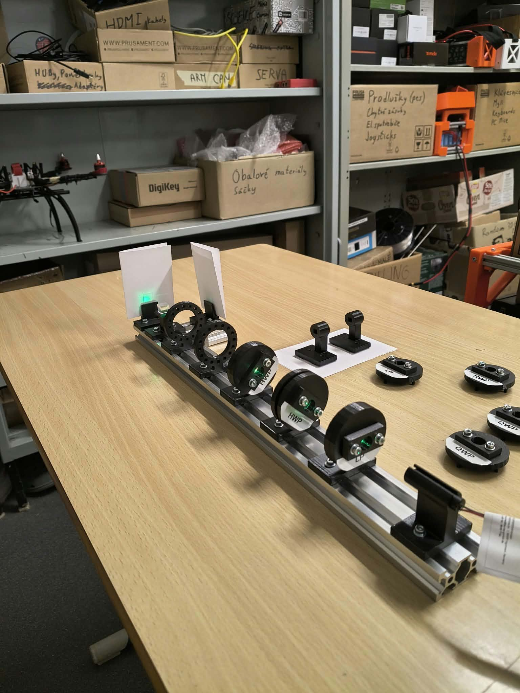 |

*The single- and double-plate tests. The photograph records the cassette arrangement; its labels do not measure the true optical axes.*

For two ideal plates at +45°, the matrices multiply to

$
XX=
\begin{pmatrix}0&1\\1&0\end{pmatrix}
\begin{pmatrix}0&1\\1&0\end{pmatrix}
=\begin{pmatrix}1&0\\0&1\end{pmatrix}=I.
$

Applying them to H therefore gives $XX|H\rangle=I|H\rangle=|H\rangle$: an ideal 100/0 return.

The −45° HWP has a slightly different matrix, $W_{1/2}(-45^\circ)=-X$. When it follows the +45° plate,

$
(-X)X=
\begin{pmatrix}0&-1\\-1&0\end{pmatrix}
\begin{pmatrix}0&1\\1&0\end{pmatrix}
=\begin{pmatrix}-1&0\\0&-1\end{pmatrix}=-I.
$

On H input this produces $(-1,0)^T$. Its intensities are still $(|-1|^2,|0|^2)=(1,0)$. Multiplying the entire state by −1 changes only its global phase, so both ideal pairs return the same polarization and intensity pattern.

In practice the crossed +45°/−45° combination looked better than some same-orientation combinations. This was one point where the real apparatus became more interesting than simply matching the expected bright spot. Two equal-retardance plates with orthogonal axes can cancel a shared retardance error, which is a possible explanation. I did not characterize the foils well enough to prove it. Across different states and sequences I saw results ranging from nearly one bright channel to appearances around 60/40.

## 5. Reaching the Deutsch–Jozsa experiment

This was the sequence I had wanted to reach from the start:

`LP(H) → HWP(22.5°) → Oracle → HWP(22.5°) → PBS`.

For a one-bit Boolean function, there are only four possibilities. If $f(0)=f(1)$ it is constant; otherwise it is balanced. I use the phase-oracle form,

$$
U_f|x\rangle=(-1)^{f(x)}|x\rangle.
$$

| f(0) | f(1) | Class | Phase oracle |
| --- | --- | --- | --- |
| 0 | 0 | Constant | I |
| 1 | 1 | Constant | −I |
| 0 | 1 | Balanced | Z |
| 1 | 0 | Balanced | −Z |

The signs multiplying the entire oracle are global phases, so I only need to compare identity and Z. I leave the oracle position empty for identity and insert an HWP at 0° for Z.

The first Hadamard makes a superposition, the oracle changes its phases, and the last Hadamard makes the difference visible:

$$
HU_fH|0\rangle=
\frac{(-1)^{f(0)}+(-1)^{f(1)}}{2}|0\rangle+
\frac{(-1)^{f(0)}-(-1)^{f(1)}}{2}|1\rangle.
$$

For a constant function, the V amplitude cancels and I expect 100/0. For a balanced function, H cancels and I expect 0/100. Equivalently, $HIH=I$ while $HZH=X$.

| Constant: identity oracle | Balanced: Z oracle |
| --- | --- |
| 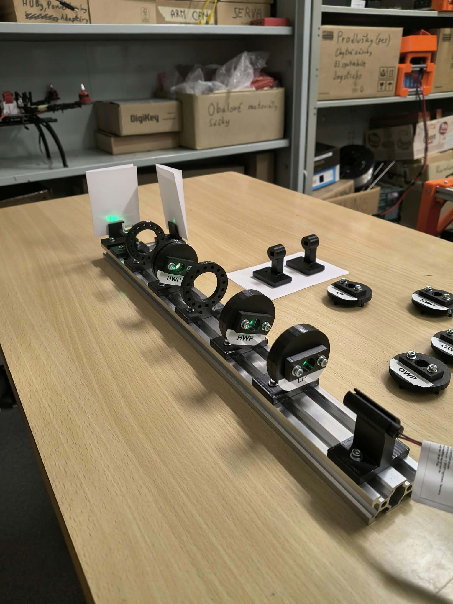 | 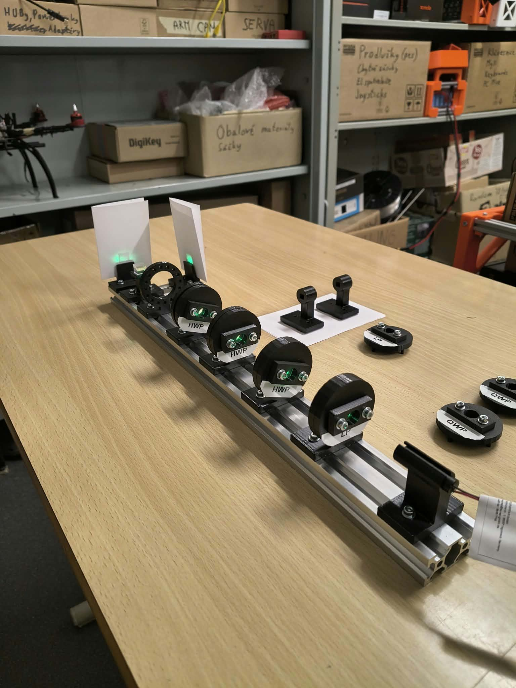 |

*The two oracle configurations. Inserting a phase plate changes which output is bright after the final Hadamard.*

I saw the expected qualitative output swap, although the unwanted channel was not completely dark. By then I was composing three real HWPs, so axis offsets, retardance errors and alignment all had opportunities to affect the contrast.

In the ideal oracle model, one query distinguishes the two classes; a deterministic classical bit-query procedure needs both function values in the worst case. My apparatus is a classical optical implementation of the phase transformation and does not demonstrate quantum advantage. In the usual two-register bit-flip version, a target prepared as $|-\rangle$ factors out the phase $(-1)^{f(x)}$ on the input. I implement that reduced phase action, without an extra physical target register.

## 6. Looking for the phase that H/V could not show

For the last comparison I used a QWP. I wanted two states that looked alike in H/V, then an analyzer that would tell them apart.

I photographed two chains before the final analyzer:

- A: `LP(H) → HWP(22.5°) → PBS`.
- B: `LP(H) → HWP(22.5°) → QWP(0°) → PBS`.

A prepares $|+\rangle=(1,1)^T/\sqrt2$. With my QWP convention, the extra matrix in B gives

$
Q|+\rangle=
\begin{pmatrix}1&0\\0&i\end{pmatrix}
\frac1{\sqrt2}\begin{pmatrix}1\\1\end{pmatrix}
=\frac1{\sqrt2}\begin{pmatrix}1\\i\end{pmatrix}
=|\psi_i\rangle.
$

The V amplitude now has a relative phase of a quarter-cycle. Its squared magnitude remains $|i/\sqrt2|^2=1/2$.

Both give ideal 50/50 H/V outputs. The PBS alone cannot reveal their relative-phase difference.

| A: without QWP | B: with QWP |
| --- | --- |
| 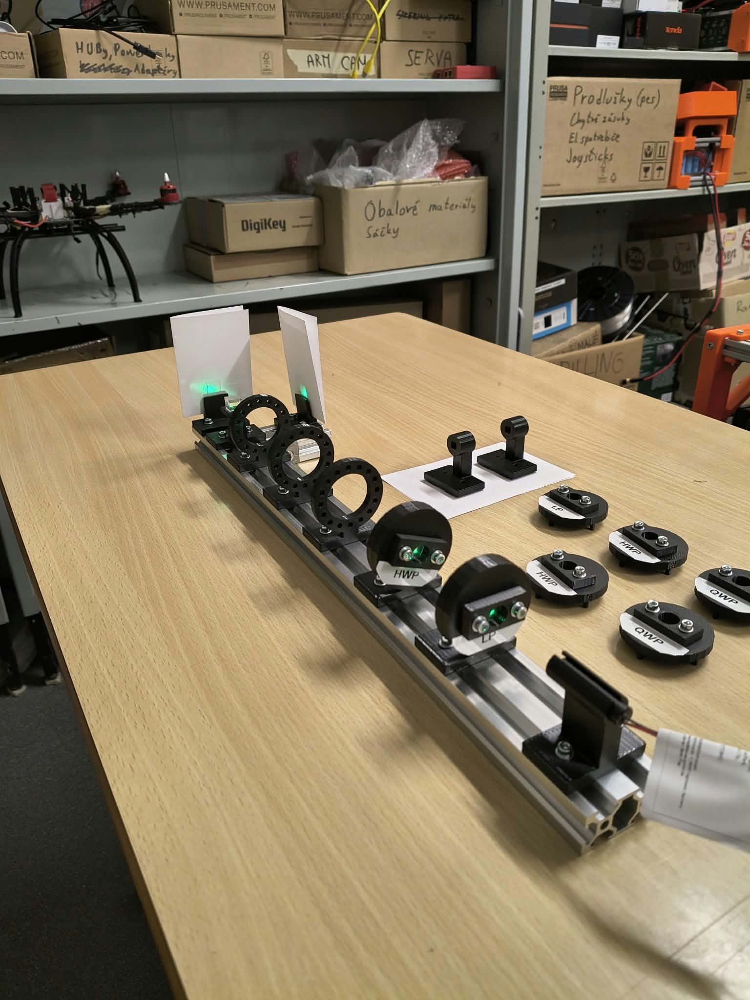 | 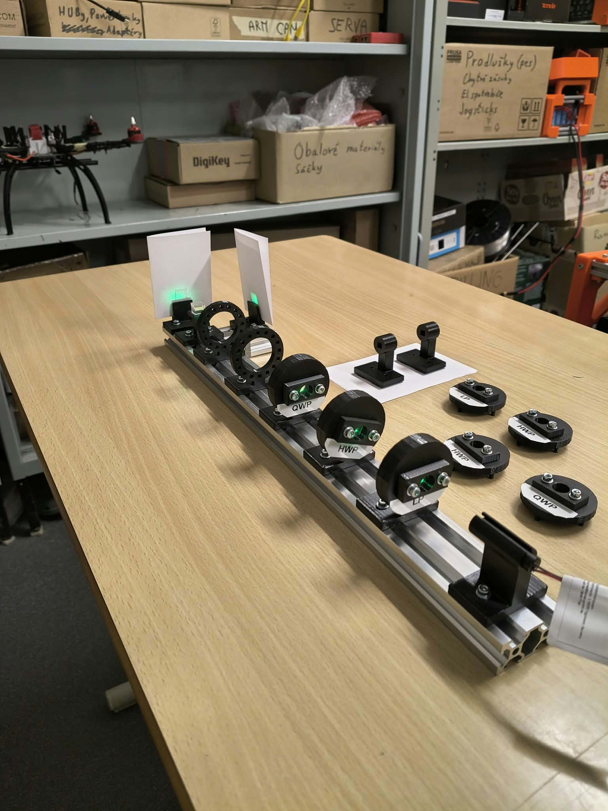 |

*Before the final analyzer: the ideal H/V intensities are the same for both states.*

I then put an HWP at 22.5° immediately before the PBS in each chain. In B the full sequence is LP, HWP, QWP, HWP, using four cassette positions.

The extra Hadamard changes the analysis basis. In A, the two equal amplitudes add in the top entry and cancel in the bottom one:

$
H\frac1{\sqrt2}\begin{pmatrix}1\\1\end{pmatrix}
=\frac12\begin{pmatrix}1+1\\1-1\end{pmatrix}
=\begin{pmatrix}1\\0\end{pmatrix}=|H\rangle.
$

In B, the phase changes those sums:

$
H\frac1{\sqrt2}\begin{pmatrix}1\\i\end{pmatrix}
=\frac12\begin{pmatrix}1+i\\1-i\end{pmatrix}.
$

Here $|(1+i)/2|^2=(1^2+1^2)/4=1/2$, and the bottom entry has the same squared magnitude. I therefore expect A to become 100/0 while B remains 50/50.

| A after the analyzer | B after the analyzer |
| --- | --- |
| 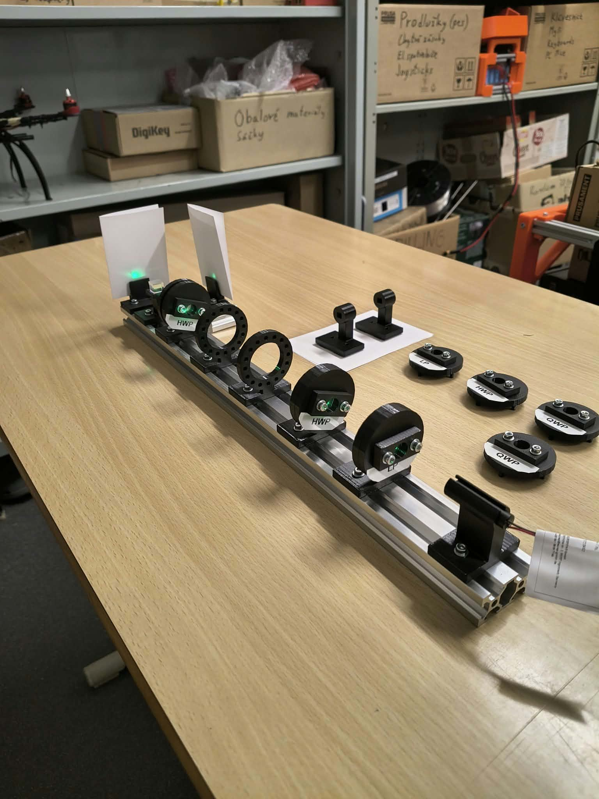 | 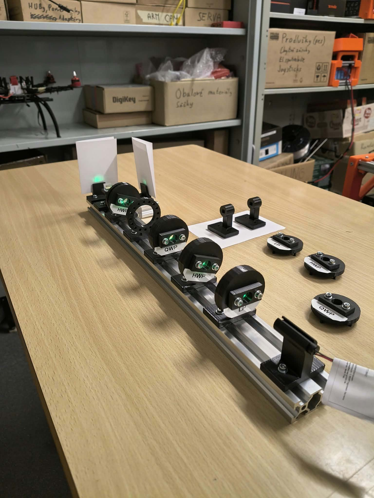 |

*The completed comparison. By eye I estimated roughly 80/20 without QWP and 40/60 with QWP after the analyzer; the ideal model predicts 100/0 and 50/50.*

This gave me the distinction I was looking for: one case became clearly dominated by one output, while the other stayed much closer to an even split. The results were imperfect, and I did not measure those ratios with detectors. I also would not claim that two equal H/V spots alone prove circular polarization or that this comparison amounts to full state tomography.

It was a useful place to finish. The phase was invisible in one measurement basis and affected the output in another, with the same plates and paper targets I had started with.
