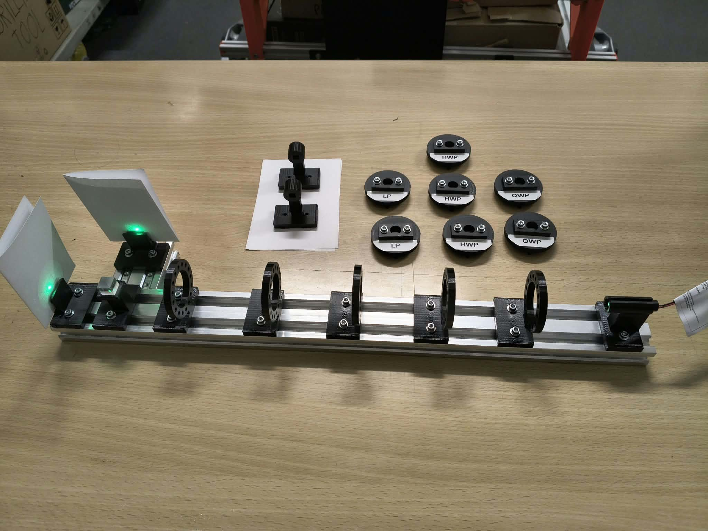

# Photographs and circuit illustrations

[My project](../README.md) · [The experiments, with photographs](../docs/04-experiments.md)

I photographed the whole apparatus and the optical sequences below. The overview shows five cassette holders and seven labeled cassettes: three HWP, two QWP and two LP. Light travels from the laser on the right toward the PBS on the left in this view.

*The assembled rail and removable optics. The two spots come from the laser and PBS with no foil cassette inserted.*

I keep the original filenames so the photographs remain easy to match to the experiments. Here LP means linear polarizer, HWP half-wave plate, QWP quarter-wave plate and PBS polarizing beam splitter. Every chain starts at the laser and ends at the PBS; empty holders are omitted.

| Photograph | Configuration / caption |
| --- | --- |
| `full_setup.jpg` | Complete apparatus, cassette inventory and the laser/PBS starting configuration. |
| `lp_h.jpg` | LP set to H; preparation and the corresponding PBS output. |
| `lp_v.jpg` | LP set to V; the same preparation test after rotating the polarizer. |
| `hadamard.jpg` | LP(H) → HWP(22.5°); my Hadamard analog. |
| `double_hadamard.jpg` | LP(H) → HWP(22.5°) → HWP(22.5°); returning toward the input polarization. |
| `not.jpg` | LP(H) → HWP(45°); swapping the bright output. |
| `double_not.jpg` | LP(H) → two nominal X plates; the double-NOT test. The image alone does not establish exact optical axes. |
| `dj_constant_i.jpg` | LP(H) → Hadamard → identity oracle → Hadamard; constant-function case. |
| `dj_balanced_z.jpg` | LP(H) → Hadamard → Z oracle → Hadamard; balanced-function case. |
| `6_exp_a_before.jpg` | A: LP(H) → HWP(22.5°), before adding the final analyzer plate. |
| `6_exp_a_after.jpg` | A with a second HWP at 22.5° immediately before the PBS. |
| `6_exp_b_before.jpg` | B: LP(H) → HWP(22.5°) → QWP(0°), before the final analyzer. |
| `6_exp_b_after.jpg` | B with the final HWP analyzer added before the PBS. |

The experiment chapter displays these pictures beside their explanation. I use them to show the arrangements and visible spots, not to calculate intensities from pixels. Exposure, saturation, viewing angle and scattering make that unreliable.

## Electronics illustrations

For the [electronics chapter](../docs/03-hardware-and-development.md), I have included a 3D PCB render and my schematic. The render shows the design rather than a photograph of the assembled board.

| File | What it shows |
| --- | --- |
| `pcb_render.png` | 3D view of my detector/controller PCB, with the two LEDs, button, controller, amplifier and connectors. |
| `schema.png` | A PNG rendering of the supplied one-page schematic PDF, displayed directly in the chapter. |
| `schema.pdf` | The original schematic document, retained unchanged for [full-size viewing](schema.pdf). |

## CAD previews

I copied these seven existing OpenSCAD previews from `construction/assemblies/previews/` into this directory without changing their contents. They illustrate the mechanical design in chapters [2](../docs/02-optical-components.md) and [3](../docs/03-hardware-and-development.md).

| File | What it shows |
| --- | --- |
| `assembly-full.png` | Saved rail assembly, with four cassette holders and main/reflected detector positions. The photographed build has five holders. |
| `holder-laser.png` | Laser holder and rail mount. |
| `holder-pbs.png` | PBS holder and rail mount. |
| `holder-rotation-stator.png` | Fixed indexed ring and its mounting foot. |
| `part-rotation-rotor.png` | Removable indexed rotor. |
| `part-filter-cassette.png` | Separate foil cassette and attachment holes. |
| `holder-bpw34.png` | BPW34 detector holder model. |

## Calculated illustrations

`waveplate-rotation.svg` shows ideal polarization trajectories and normalized H/V outputs for fixed H input while rotating an HWP or QWP. I calculated it using the Jones convention in the [theory chapter](../docs/01-theory.md#turning-a-plate-into-a-matrix). The curves trace the electric field at one point over time; they are not photographs, beam paths or measurements of my foils.

I have not included photographs of soldering or the programming setup. The actual design files remain in [construction](../construction/) and [electro](../electro/main/). While taking photographs, I keep my eyes out of the beam and specular reflections and use suitable beam stops and laser safety practices.
